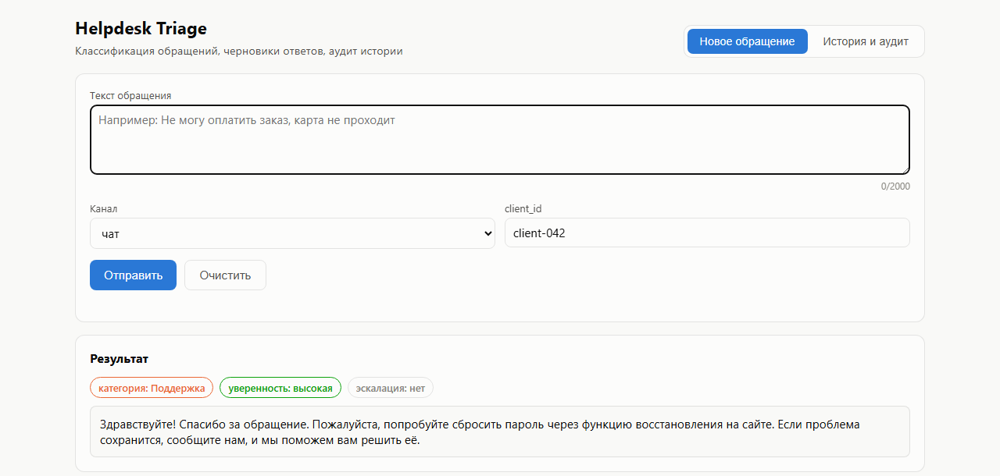
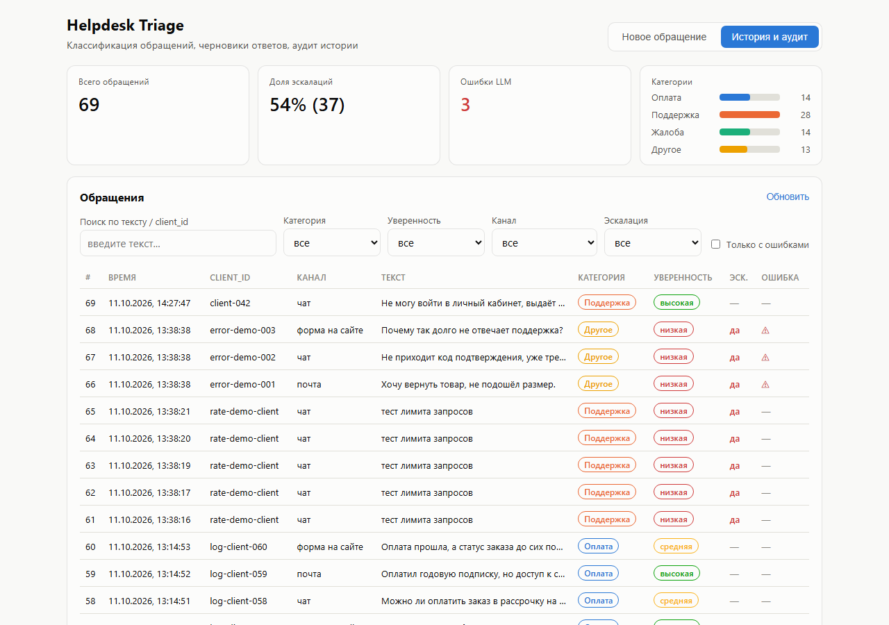
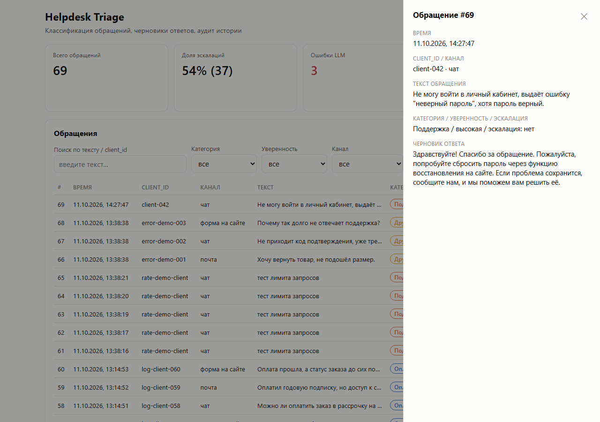

# Helpdesk Triage MVP

Сервис первичной обработки обращений клиентов: принимает текст обращения,
классифицирует его через LLM, готовит черновик ответа и сохраняет историю
в SQLite. Учебный MVP — один эндпоинт, без интеграции с реальной почтой/формой.

## Контракт API

**POST /triage**

Запрос:

```json
{
  "text": "У меня не работает вход в личный кабинет",
  "channel": "chat",
  "client_id": "client-001"
}
```

- `text` — строка, 1–2000 символов, обязательно
- `channel` — одно из `"email" | "form" | "chat"`
- `client_id` — строка, используется для лимитирования запросов

Ответ (200):

```json
{
  "category": "support",
  "draft_reply": "Спасибо за обращение! Уточните, пожалуйста...",
  "confidence": "high",
  "escalate": false
}
```

- `category` — одно из `billing | support | complaint | other`
- `confidence` — одно из `high | medium | low`
- `escalate` — `true`, если обращение нужно передать оператору (низкая
  уверенность, ошибка LLM, жалоба)

Ошибки: `422` — невалидный вход, `429` — превышен лимит запросов на `client_id`.

**GET /tickets** — история для аудита, с фильтрами и пагинацией:
`?limit=&offset=&category=&confidence=&escalate=&channel=&q=&only_errors=`.
Ответ: `{"items": [...], "total": N}`.

**GET /stats** — агрегаты для дашборда: `total`, `escalated`, `errors`,
`by_category`, `by_confidence`.

## Запуск за 5 минут

### 1. Переменные окружения

```bash
cp .env.example .env
```

Открыть `.env` и вписать свой ключ от [proxyapi.ru](https://proxyapi.ru)
в `PROXYAPI_KEY` (это OpenAI-совместимый прокси, работает без VPN и
российской карты). Остальные переменные можно оставить по умолчанию.

### 2а. Локальный запуск (venv)

```bash
python -m venv venv
# Windows:
venv\Scripts\activate
# Linux/Mac:
source venv/bin/activate

pip install -r requirements.txt
uvicorn app.main:app --reload
```

Сервис поднимется на `http://127.0.0.1:8000`.

### 2б. Запуск в Docker

```bash
docker compose up --build
```

Сервис поднимется на `http://localhost:8000`, файл SQLite будет лежать в
`./data/tickets.db` (volume примонтирован в `docker-compose.yml`).

### 3. Проверка

```bash
curl -X POST http://127.0.0.1:8000/triage \
  -H "Content-Type: application/json" \
  -d '{"text":"Не могу оплатить заказ, карта не проходит","channel":"chat","client_id":"demo-client-1"}'
```

Ожидаемый ответ (пример, зависит от LLM):

```json
{"category":"billing","draft_reply":"...","confidence":"medium","escalate":false}
```

Если ключ LLM не задан/невалиден или сервис недоступен — сработает
fallback-сценарий: `category="other"`, `confidence="low"`,
`escalate=true`, `draft_reply="Ваше обращение передано оператору..."`.

### Веб-интерфейс для демо

Открой `http://127.0.0.1:8000/` в браузере. Интерфейс — отдельный модуль
проекта (`frontend/`, не часть backend-пакета `app/`), FastAPI отдаёт его
как статику. Два раздела:

- **«Новое обращение»** — форма (текст, канал, client_id), после отправки
  сразу показывает результат (категория/confidence/escalate + черновик
  ответа).
- **«История и аудит»** — таблица всех обращений из SQLite с:
  - стат-плашками (всего обращений, доля эскалаций, ошибки LLM) и
    мини-графиком распределения по категориям;
  - фильтрами (категория, confidence, канал, эскалация, только с
    ошибками, поиск по тексту/client_id);
  - пагинацией;
  - детальной панелью по клику на строку (полный текст, черновик ответа,
    текст ошибки LLM, если была).

Подходит для записи демо-видео без curl/Postman. Есть и интерактивная
документация API: `/docs` (Swagger UI) и `/redoc`.

**Скриншоты:**

| Новое обращение | История и аудит | Детальная панель |
|---|---|---|
|  |  |  |

### Прогон демо-набора обращений

```bash
python scripts/demo_requests.py --repeat 10
```

Прогонит 6 примеров обращений (billing/support/complaint/прочее) по 10
раз — удобно для записи демо-видео и сбора лога ~60 ответов.

## Где смотреть результаты

**SQLite** (аудит история — таблица `tickets`):

```bash
sqlite3 tickets.db "SELECT id, created_at, client_id, channel, category, confidence, escalate, error FROM tickets ORDER BY id DESC LIMIT 20;"
```

Либо открыть файл `tickets.db` (или `data/tickets.db` при запуске в Docker)
через [DB Browser for SQLite](https://sqlitebrowser.org/).

**Логи** — выводятся в консоль, где запущен `uvicorn`/Docker-контейнер
(`docker compose logs -f`). Ошибки LLM и факты эскалации логируются уровнем
`ERROR` и дублируются в поле `error` таблицы `tickets`.

## Надёжность и безопасность

- **Валидация входа**: pydantic проверяет длину `text` (1–2000) и
  допустимые значения `channel`.
- **Секреты**: ключ LLM читается только из `.env` (см. `app/config.py`),
  в коде/репозитории ключа нет (`.env` в `.gitignore`).
- **Rate limiting**: простой in-memory sliding-window лимитер
  (`app/rate_limit.py`) — не больше `RATE_LIMIT_PER_MINUTE` запросов в
  минуту на один `client_id`. Ограничение: работает в рамках одного
  процесса, для продакшена нужен Redis или аналог.
- **Fallback при сбое LLM**: любая ошибка вызова модели или невалидный
  JSON в ответе → `escalate=true`, `confidence="low"`, шаблонный
  `draft_reply`, текст ошибки сохраняется в поле `error` в БД. Запрос
  при этом всё равно возвращает `200`, чтобы клиент получил
  предсказуемый ответ.

## LLM-слой

- Провайдер: [proxyapi.ru](https://proxyapi.ru) (OpenAI-совместимый API).
- Модель по умолчанию: `openai/gpt-4.1-mini`, `temperature=0.2` (низкая
  температура — меньше "фантазии", выше опора на входной текст).
  *Важно:* reasoning-модели линейки `gpt-5-*` на момент написания не
  поддерживают кастомную `temperature` (только дефолт =1) и вернут 400
  ошибку — а для этого проекта управляемая температура нужна по
  заданию, поэтому выбрана обычная chat-модель `gpt-4.1-mini`.
- Системный промпт (`app/llm_client.py`) жёстко задаёт роль, запрещает
  выдумывать факты и фиксирует правило:
  мало данных/неоднозначность → `confidence=low` + `escalate=true`.
- Ответ модели запрашивается в формате JSON (`response_format:
  json_object`) и валидируется pydantic-схемой; при любом несовпадении
  формата запрос уходит в fallback-сценарий, а не падает с ошибкой.

## Тесты

```bash
pytest tests/ -v
```

Покрывают: успешный сценарий, валидацию (пустой текст, неверный канал,
превышение длины), fallback при ошибке LLM и срабатывание rate limit.
LLM в тестах замокан — реальные запросы к proxyapi.ru не выполняются.

## Структура проекта

```
app/                — backend (FastAPI)
├── main.py           — POST /triage, GET /tickets, GET /stats, GET /
├── schemas.py        — pydantic-модели запроса/ответа
├── llm_client.py     — системный промпт, вызов LLM, парсинг/валидация JSON
├── db.py             — инициализация SQLite, запись/чтение/статистика тикетов
├── rate_limit.py      — in-memory лимитер по client_id
└── config.py          — настройки из .env

frontend/            — веб-интерфейс, отдельный модуль (не часть app/)
├── index.html         — разметка: форма + дашборд истории
├── style.css           — стили (светлая/тёмная тема)
└── app.js               — логика: fetch к API, фильтры, пагинация, drawer

tests/               — pytest-тесты (LLM замокан)
scripts/             — скрипт для демо-прогона обращений
```

Backend не содержит фронтенд-кода и ничего не знает о его внутренностях —
`app/main.py` лишь монтирует `frontend/` как статику и отдаёт `index.html`
на `/`. Для простоты запуска (чтобы уложиться в "5–10 минут") оба модуля
по-прежнему поднимаются одним процессом `uvicorn`, без отдельного
Node.js/сборки — `frontend/` обычный HTML/CSS/JS без build-шага.

## Ограничения MVP (сознательные)

- Один эндпоинт (`POST /triage`), без RAG/базы знаний.
- Максимум 4 категории обращений.
- Rate limiter и SQLite — однопроцессные решения, не рассчитаны на
  горизонтальное масштабирование.
- Каналы (`email`/`form`/`chat`) — только метка для аналитики, реальные
  интеграции с почтой/формой/чатом не подключены.
